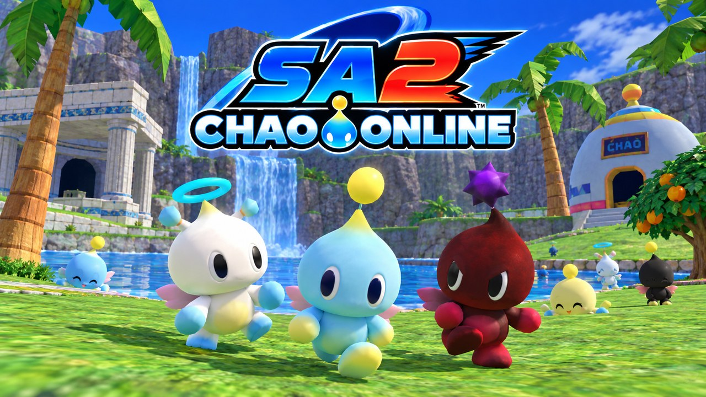

# SA2 Chao Online



Online multiplayer for **Sonic Adventure 2** (Steam PC), for up to 8 players. It's a mod for the
[SA2 Mod Loader](https://github.com/X-Hax/sa2-mod-loader).

- See your friends in stages and Chao gardens.
- Make a party to play together: stages start at the same time, story mode included, and you can
  race each other or clear stages co-op.
- Kart races and treasure hunts against each other.
- Your Chao can visit friends' gardens, run in their Chao Races and fight them in karate.
- Inspect your Chao's hidden stats, temperament, emotions, alignment and bonds in F9.
- Text chat, and a "go to friend" option to jump to where someone is.

Press **F9** in game for the menu. Multiplayer stays off until you turn it on. There's also an
optional dedicated server (Docker image or Windows exe) so nobody has to host.

## Players

Download the zip from **[Releases](../../releases/latest)**, extract it into the game's `mods`
folder and enable "SA2 Chao Online" in SA Mod Manager. Then read
**[how to play](docs/how-to-play.md)**. It works on Windows and on Linux through Proton. You need
your own Steam copy of the game.

For automatic updates before each Steam launch, set up the optional
[launcher](docs/setup.md#automatic-updates-when-launching-from-steam-windows) once. It installs
new mod releases without update prompts and keeps your settings and saves.

Karate needs the game's Battle DLC.

## Developers

| | |
|---|---|
| [docs/setup.md](docs/setup.md) | Building on Windows and Linux |
| [docs/testing.md](docs/testing.md) | The fake second player and a test checklist |
| [docs/protocol.md](docs/protocol.md) | Network messages |
| [docs/game-version.md](docs/game-version.md) | The game build the addresses are for |
| [re/](re/addresses.md) | Reverse-engineering notes |

```
src/          the mod (Rust)
src/bin/      dedicated server, automatic-update launcher, and fakepeer (a test player)
mod/          mod.ini and the SA Mod Manager settings page
scripts/      build, install and package scripts
tools/        small analysis scripts
```

## License

MIT, see [LICENSE](LICENSE). Sonic Adventure 2 is © SEGA. This project isn't affiliated with SEGA
and contains no game files.
